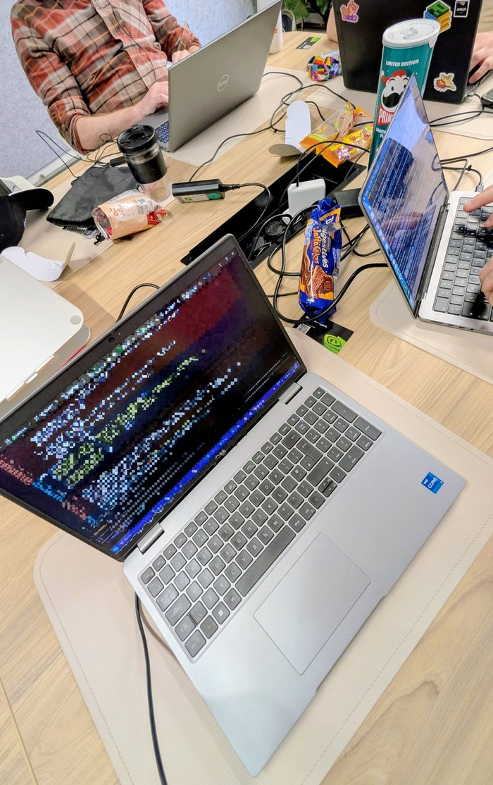
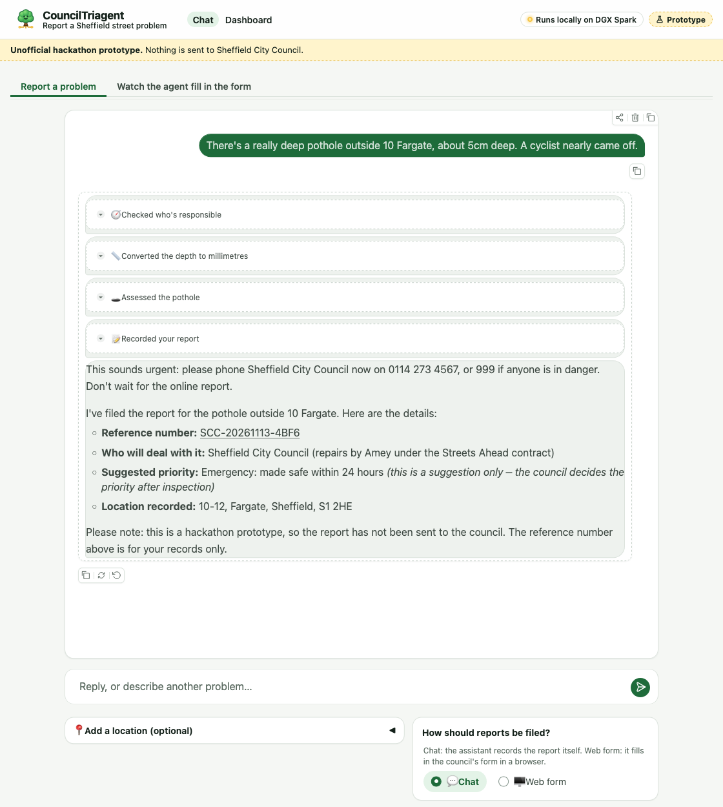
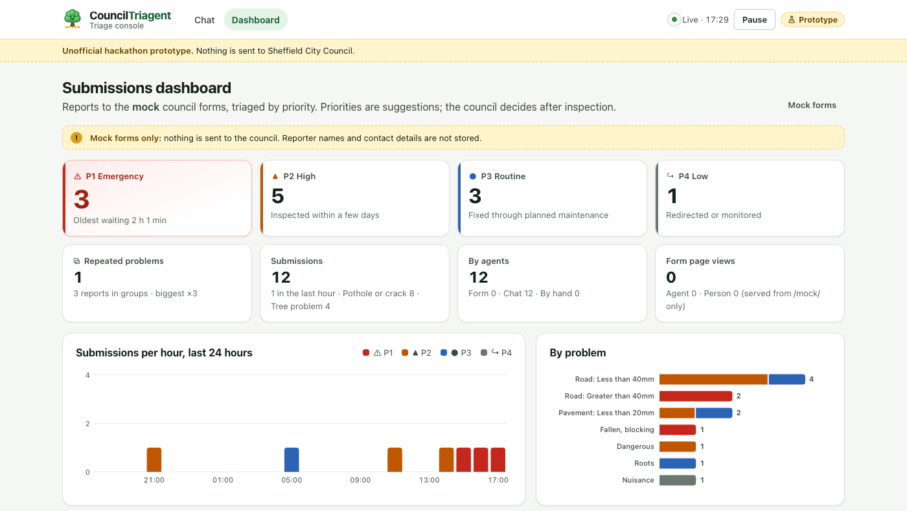
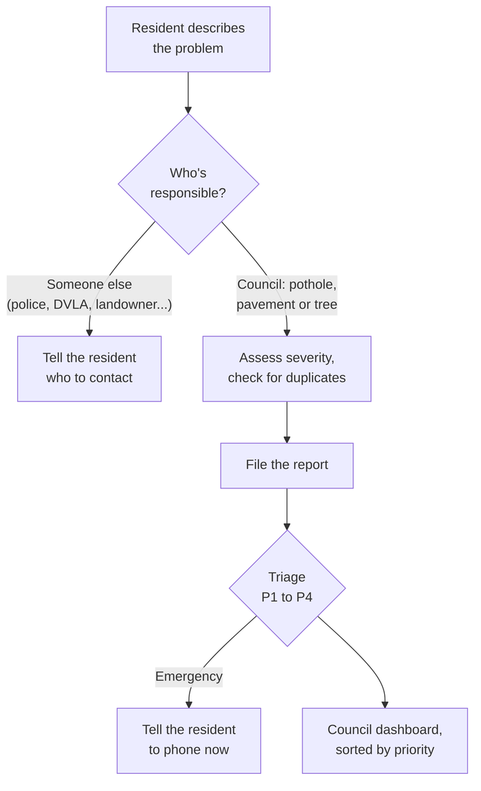

On Friday 13 November, four Research Software Engineers (RSE) from [Research & Innovation IT](https://sheffield.ac.uk/it-services/about) and the [Research Software Engineering group](https://rse.shef.ac.uk/) spent the day at [NVIDIA Hack for Impact Sheffield](https://events.nvidia.com/hack-for-impact-sheffield/) - a one-day, collaborative hackathon hosted by NVIDIA. Teams were asked to *"Build autonomous systems that think, act, and run anywhere, whilst also making a positive impact on the world"* using open AI models. Each group was also provided with an NVIDIA DGX Spark, which is a desktop-sized AI computer, to build and deploy their agents on the day.

<!--more-->

Our team (democratically elected as "Dependency Hell's Angels") consisted of [Joe Heffer](https://heffer.info/), [Edwin Brown](https://rse.shef.ac.uk/contact/edwin-brown/), [Shaun Donnelly](https://rse.shef.ac.uk/contact/shaun-donnelly/) and [Farhad Allian](https://www.farhadallian.co.uk/). Our initial goal before the event was to get together and brainstorm potential problems that could be solved using agentic systems aligned with the hackathon's three themes, namely: economic systems, public services and urban operations. In the end, we identified a common issue residents face with reporting street problems in Sheffield. For instance, [Sheffield City Council's 2025-26 Complaint Service Improvement Plan](https://democracy.sheffield.gov.uk/mgConvert2PDF.aspx?ID=78987) report highlighted challenges in logging and tracking residents' issues using their existing digital systems. Relatedly, [the Sheffield City Council Report Road and Pavement Problems hub](https://www.sheffield.gov.uk/roads-pavements/report-problems) divides reporting street problems into seven separate categories (including potholes, plants/trees, flooding/drains, spillages, bridges/walls, traffic lights, and streetlights). Residents must also use this hub to determine if a specific road is managed by [National Highways](https://www.sheffield.gov.uk/roads-pavements/report-problems/report-road-problems), or if a water issue belongs to the local water company or the [Environment Agency](https://www.sheffield.gov.uk/roads-pavements/report-problems/flooding-blocked-road-drains) before reporting a problem. Therefore, the common denominator for both these problems is the lack of a cohesive workflow that residents can readily use with minimal effort to report their street problems, and a prioritisation mechanism in place for the city's council to sort and direct those reports to the relevant services. To tackle these issues, our team designed and developed **Council Triagent** - an agentic triage system that allows residents to report a street problem in their own words, works out who is responsible, files the report, and ultimately helps the council to prioritise each issue.

<figure class="text-center">
  
  <figcaption style="font-weight: normal; margin-top: 0.75rem;"><strong>Figure 1:</strong> Dependency Hell's Angels at NVIDIA Hack for Impact Sheffield.</figcaption>
</figure>

## The Council Triagent

On a surface level, the Council Triagent has two main components to it: a chat interface for residents to report their street problems, and separately a triage system with a live dashboard for the council to prioritise those problems. On the resident side, the workflow consists of the user initially describing the problem in their own words, and can optionally attach a photo or drop a pin on a map. The agent then clarifies the scope of the problem (for example, roughly how deep a reported pothole is), reasons who is responsible for that road, assesses the severity of the problem against the rules on the council's own reporting forms, and then files the report with a reference number. If the problem belongs to someone other than the council, such as National Highways, the DVLA or the police, the agent tells the resident who to contact instead. If the problem is urgent, the resident is advised to phone the council straight away.

<figure class="text-center">
  
  <figcaption style="font-weight: normal; margin-top: 0.75rem;"><strong>Figure 2:</strong> The resident chat interface. Here, a 5 cm pothole on Fargate is reported, filed with a reference number, and flagged as an emergency.</figcaption>
</figure>

On the council side, every report appears on a dashboard and is assigned a suggested priority from P1 (Emergency) to P4 (Low), along with the reasons for that decision in plain English. Reports of the same problem made within a short distance and time of each other are grouped together on a map, so that a pothole reported by three different residents becomes a single job that moves up the queue, rather than three separate reports for staff to cross-check by hand.

<figure class="text-center">
  
  <figcaption style="font-weight: normal; margin-top: 0.75rem;"><strong>Figure 3:</strong> The council triage dashboard, showing reports by priority, submissions per hour and reports by problem type.</figcaption>
</figure>

Since many councils only accept reports through web forms, we also built a browser agent that fills in the form page by page, in the same way a person would. This is a challenging problem in its own right, as the agent has to read each page, choose the right answers and recover from its own mistakes. During testing on the day, it completed our mock copy of the council's pothole form in 12 to 13 steps, and corrected itself when the form flagged a missing answer. Everything ran locally on the DGX Spark using open models, namely NVIDIA's Nemotron for the chat and triage, and Qwen for reading photos and driving the browser, meaning no residents' data was sent to an external cloud service. The prototype was also tested against mock copies of the council's forms, so no reports were sent to Sheffield City Council's live systems. As part of our submission, we also produced a short demo video that walks through the entire workflow, from a resident reporting a problem to the triaged report appearing on the council's dashboard. You can watch it below or on [YouTube](https://www.youtube.com/watch?v=_SawWrNYCLo).

<iframe width="640" height="360" src="https://www.youtube.com/embed/_SawWrNYCLo" title="Council Triagent demo" frameborder="0" allow="accelerometer; autoplay; clipboard-write; encrypted-media; gyroscope; picture-in-picture; web-share" allowfullscreen></iframe>

## Design choices and architecture

Rather than building a general-purpose chatbot, the Council Triagent is an agentic system, with access to a set of tools, each of which carries out one well-defined job that helps it solve the problems at hand. For instance, this includes tools to work out who is responsible for a given problem, assess its severity against the council's form rules, and then to file the report. The AI model's reasoning capabilities enable it to decide which tool to use and when, but the checks themselves are made by the tools, meaning we could keep the agent's behaviour predictable and testable.

<figure class="text-center">
  
  <figcaption style="font-weight: normal; margin-top: 0.75rem;"><strong>Figure 4:</strong> The journey of a single report through Council Triagent, from the resident's description to the council's dashboard.</figcaption>
</figure>

Similarly, we chose not to let the AI model set each report's priority on its own. Instead, each service has a short set of questions (for example, how deep is the defect, and is anyone hurt), with each answer worth a fixed number of points, following the risk-based approach of the national Code of Practice *Well-managed Highway Infrastructure*. The model is only asked about the questions that the form and the resident's own words leave unanswered. As a result, every priority can be traced back to the answers that produced it, and triage continues to work even if the model is unavailable. Finally, every change merged on GitHub was deployed automatically to the Spark, which allowed the four of us to simultaneously work on the same system throughout the day.

## Lessons learned

Despite the focus of the hackathon being on using agentic systems to solve an impactful problem, a large proportion of our time was spent understanding the problem itself. In particular, working out which organisation is responsible for which roads and problems in Sheffield, and what information each of the council's forms actually requires, turned out to be just as important as developing the software behind the agent. In other words, the agent can only be as good as the rules and information it is given.

We also found that AI agents need clear boundaries. Early versions of our form-filling agent occasionally went round in circles until they reached their step limit, and on one occasion tried to submit a report without asking the user first. After adding a few simple checks, the agent now shows the resident their answers and waits for confirmation before submitting anything. For any system that acts on someone's behalf, we believe these kinds of safeguards should be designed in from the start rather than added later. Similarly, we learned that not every decision should be left to the AI model. Combining written rules with the model's ability to interpret free text gave us decisions that could be explained to council staff, which is essential for any system used in a public service.

Furthermore, we tried three open models of similar size on the DGX Spark, and found large differences between them for the same task. For example, filing a text-only report took around 6 to 8 seconds with Nemotron 3.5 Lightning with its reasoning switched off, around 30 seconds with reasoning on, and 41 to 60 seconds with the older Nemotron Nano (see [`models.py`](https://github.com/rcgsheffield/hack-for-impact/blob/main/src/app/models.py) in our repository). This was particularly important given that a single machine was serving the whole system, and the whole team, for the day. Running everything locally also had the obvious benefit of privacy. Street reports often include photos of people's homes, vehicles and neighbours, and keeping all of this on hardware that a council could own in the future means that residents' data never has to leave the building.

## Looking ahead

It is worth reflecting on what can realistically be achieved in a one-day Hackathon. While our simple prototype shows that the idea could work in practice, our test set was small and written by the team, and the system has only been used with mock forms. We have documented these limitations alongside the code so that anyone building on our codebase knows where it currently stands. The codebase for Council Triagent is open source and available on GitHub at [rcgsheffield/hack-for-impact](https://github.com/rcgsheffield/hack-for-impact). For a fully functioning software product, an obvious next-step would be to connect the system to council case management systems through Open311 (the open standard used by FixMyStreet), and extending it to cover other council services such as bins, street lighting and fly-tipping.

More broadly, the hackathon was a pleasant opportunity for our team to get together and apply our knowledge and skills of agentic workflows to develop a product that could be used by councils or similar services in the future - a solution that many researchers are increasingly asking us about. Many of the questions we faced on the day, such as where the data goes, what an agent should be allowed to do, and whether its outputs can be trusted, are the same questions that arise in our research projects using AI, and our pool of skilled engineers are the ones best equipped to further enable research and innovation at the university.

## Get in touch

If you are considering using AI or agentic systems in your research, please get in touch. It is best to contact us early, ideally before your project starts, and certainly before you submit a grant application.

- The **[Research Software Engineering](https://rse.shef.ac.uk/)** team leads, supports, and guides the research community in leveraging software and data engineering to produce excellent research.
- The **[Data Analytics Service](https://students.sheffield.ac.uk/it-services/research/data-analysis-support)** offers free one-to-one consultations to all researchers, and can also be costed into grants for up to 50% of a full-time role. Please get in touch via the [contact form](https://shef.topdesk.net/tas/public/ssp/content/serviceflow?unid=1af1d4aac41f482280efe767ca119d16) before you submit your funding application.
- **[Research computing](https://staff.sheffield.ac.uk/researchers/computing):** the Stanage computing cluster includes GPUs for AI work, alongside other research computing platforms.
- **[Research Computing Training](https://sites.google.com/sheffield.ac.uk/research-training/)** runs courses for researchers at every level.
